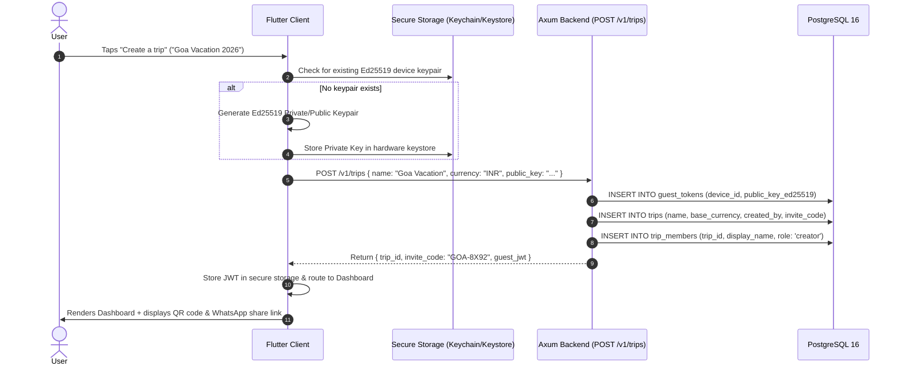
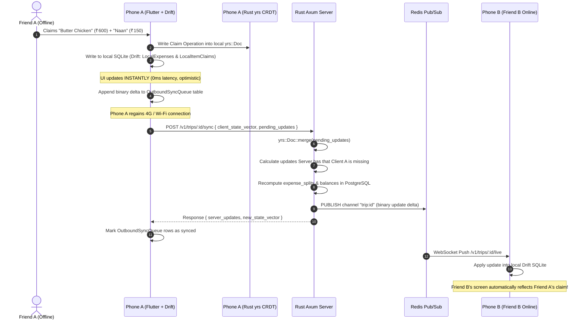

# TripWallet — Complete End-to-End Architectural Walkthrough

This document explains the **entire TripWallet system end-to-end**: how every file works, how data moves across the stack, the exact math and algorithms, and what happens step-by-step from user tap on mobile to the Rust backend and database.

---

## Table of Contents
1. [The 4 Core Technical Pillars](#1-the-4-core-technical-pillars)
2. [Lifecycle 1: Accountless Onboarding & Trip Creation](#2-lifecycle-1-accountless-onboarding--trip-creation)
3. [Lifecycle 2: Logging an Expense, Bill Proration & Offline CRDT Sync](#3-lifecycle-2-logging-an-expense-bill-proration--offline-crdt-sync)
4. [Lifecycle 3: Debt Simplification & Non-Custodial Settlement](#4-lifecycle-3-debt-simplification--non-custodial-settlement)
5. [Complete File-by-File Technical Deep Dive](#5-complete-file-by-file-technical-deep-dive)
   - [Rust Backend (`backend/crates/`)](#rust-backend-backendcrates)
   - [Flutter Client (`client/lib/`)](#flutter-client-clientlib)
   - [Database Schema (`PostgreSQL` + `SQLite`)](#database-schema-postgresql--sqlite)
6. [Why This Architecture? (Key Design Decisions)](#6-why-this-architecture-key-design-decisions)

---

## 1. The 4 Core Technical Pillars

| Pillar | Technical Solution | Why It Matters |
| :--- | :--- | :--- |
| **1. No Accounts** | Ed25519 device keypair + signed guest tokens | Guests join in 2 seconds via magic link or QR code without passwords, emails, or SMS OTPs. |
| **2. Offline-First** | `yrs` (Rust CRDT) + local `Drift` (SQLite) + state vector sync | Travelers with zero cell service can add expenses and claim dishes; updates merge deterministically when back online. |
| **3. Bill Math** | Integer `MinorUnits(i64)` + Proration engine | Financial math down to the exact paisa/cent without floating-point errors; tax/service charge prorated with zero leakage. |
| **4. Payments** | Min Cash Flow Greedy algorithm + OS Deep Links | Debt graph minimized to fewest transfers; hands off to native payment apps (GPay, PhonePe, Revolut); never custodies money. |

---

## 2. Lifecycle 1: Accountless Onboarding & Trip Creation

How does a user create or join a trip without entering an email or password?



### What Happens in the Code:
1. **Client**: [`landing_screen.dart`](client/lib/features/onboarding/presentation/landing_screen.dart) captures the trip name.
2. **Keypair Generation**: If the user has never opened the app, an asymmetric Ed25519 keypair is generated. The private key never leaves the device's secure enclave.
3. **Database**: [`20260914000001_initial_schema.sql`](backend/crates/persistence/migrations/20260914000001_initial_schema.sql) creates the `guest_tokens` row and `trip_members` row.
4. **Invite Code**: A 122-bit high-entropy code (`invite_code`) is generated for friends to scan via QR code or join with a link (`tripwallet.app/j/GOA-8X92`).

---

## 3. Lifecycle 2: Logging an Expense, Bill Proration & Offline CRDT Sync

What happens when 4 friends eat dinner at a restaurant, scan the receipt, claim dishes, and one of them is offline?



### The Exact Math Behind Bill Proration ([`proration.rs`](backend/crates/domain/src/proration.rs)):
Suppose a dinner bill has:
- **Dishes Subtotal**: ₹3,000 (Payer claimed ₹1,000; Friend claimed ₹2,000)
- **GST / Tax**: ₹250
- **Service Charge**: ₹150
- **Grand Total**: ₹3,400

1. **Calculate Proportion**:
   - Payer proportion: $\frac{1000}{3000} = \frac{1}{3} \approx 33.333\%$
   - Friend proportion: $\frac{2000}{3000} = \frac{2}{3} \approx 66.666\%$
2. **Integer Minor Unit Allocation (Paise)**:
   - Payer tax = $\lfloor 25000 \times \frac{1}{3} \rfloor = 8333$ paise (₹83.33)
   - Friend tax = $\lfloor 25000 \times \frac{2}{3} \rfloor = 16666$ paise (₹166.66)
   - Total allocated tax = $8333 + 16666 = 24999$ paise (₹249.99)
3. **Residue Correction**:
   - Total tax is ₹250.00 ($25000$ paise), but sum is ₹249.99 ($24999$ paise). 
   - **Where does the 1 paisa difference go?**
   - [`proration.rs`](backend/crates/domain/src/proration.rs) automatically assigns the rounding residue ($25000 - 24999 = 1$ paisa) to the **payer**.
   - Result: Payer pays ₹83.34; Friend pays ₹166.66. Grand total = **₹3,400.00 exactly**.
   - Verified across 256 randomized property tests via `proptest`.

---

## 4. Lifecycle 3: Debt Simplification & Non-Custodial Settlement

How does TripWallet calculate who owes whom and execute payments without holding money?

### The Greedy Cash Flow Algorithm ([`debt_simplifier.rs`](backend/crates/domain/src/debt_simplifier.rs))
Suppose 4 friends have the following raw pairwise debts:
- Alice owes Bob ₹1,000
- Bob owes Charlie ₹1,000
- Charlie owes Dave ₹500
- Alice owes Dave ₹500

Without simplification, this requires **4 separate transactions**.
TripWallet's algorithm simplifies this into minimal transfers:

1. **Calculate Net Balances**:
   - Alice: $-\text{₹}1,500$ (Debtor)
   - Bob: $\text{₹}0$ (Even)
   - Charlie: $+\text{₹}500$ (Creditor)
   - Dave: $+\text{₹}1,000$ (Creditor)
2. **Match Maximum Debtor with Maximum Creditor**:
   - Max Debtor: Alice ($-\text{₹}1,500$)
   - Max Creditor: Dave ($+\text{₹}1,000$)
   - Transfer: **Alice pays Dave ₹1,000**
   - Remaining: Alice ($-\text{₹}500$), Dave ($\text{₹}0$)
3. **Next Match**:
   - Max Debtor: Alice ($-\text{₹}500$)
   - Max Creditor: Charlie ($+\text{₹}500$)
   - Transfer: **Alice pays Charlie ₹500**
   - Remaining: All balances reach zero!

**Result**: 4 transactions reduced to **2 transactions**:
- Alice $\to$ Dave: ₹1,000
- Alice $\to$ Charlie: ₹500
- Bob makes 0 transactions!

### Deep-Link Payment Execution ([`upi.rs`](backend/crates/payments/src/upi.rs) & [`revolut.rs`](backend/crates/payments/src/revolut.rs))
When Alice taps **"Settle ₹1,000 with Dave"**:
1. Axum backend generates:
   ```
   upi://pay?pa=dave@okhdfcbank&pn=Dave&am=1000.00&cu=INR&tn=TripWallet+Settlement
   ```
2. Flutter invokes `url_launcher`:
   The mobile OS intercepts `upi://` and displays:
   *"Open with Google Pay / PhonePe / Paytm"*
3. Alice authenticates using her biometric fingerprint in Google Pay.
4. Alice switches back to TripWallet:
   The app asks: *"Did the payment go through?"* $\to$ Alice taps *"Yes"*.
5. The ledger records the settlement as confirmed; Dave receives a notification via WebSocket.
6. **Zero banking licenses or money custody needed.**

---

## 5. Complete File-by-File Technical Deep Dive

### Rust Backend (`backend/crates/`)

```
backend/
├── Cargo.toml                  # Workspace configuration (manages all crates)
└── crates/
    ├── domain/                 # Pure mathematical & business logic (Zero I/O)
    │   └── src/
    │       ├── lib.rs          # Re-exports all domain models and functions
    │       ├── models/
    │       │   ├── money.rs    # MinorUnits(i64) preventing floating-point bugs
    │       │   ├── trip.rs     # Trip, TripMember, TripStatus, MemberRole structs
    │       │   └── expense.rs  # Expense, LineItem, ItemClaim, SplitMethod structs
    │       ├── debt_simplifier.rs # Greedy min-cash-flow algorithm (BinaryHeap)
    │       └── proration.rs    # Receipt tax/service proration + proptest suite
    │
    ├── crdt-core/              # Conflict-Free Replicated Data Type engine
    │   └── src/
    │       ├── lib.rs          # Re-exports TripCrdtDoc and CrdtError
    │       └── doc.rs          # yrs::Doc wrapper, StateVector encoding, diffing
    │
    ├── payments/               # Payment URI resolvers
    │   └── src/
    │       ├── lib.rs          # Re-exports URI builders
    │       ├── upi.rs          # upi://pay URI generator for India
    │       └── revolut.rs      # revolut.me payment request URL generator
    │
    ├── persistence/            # Database layer
    │   ├── migrations/
    │   │   └── 20260914000001_initial_schema.sql # Full PostgreSQL 16 DDL
    │   └── src/
    │       ├── lib.rs          # Re-exports connection pool and migration runner
    │       └── db.rs           # PgPoolOptions initialization and sqlx::migrate!
    │
    └── api/                    # Deployable Axum web server
        └── src/
            ├── main.rs         # Server entry point, tracing, TCP listener
            ├── state.rs        # AppState holding PgPool and app version
            └── routes/
                ├── mod.rs      # Route module exports
                └── health.rs   # GET /health & GET /ready probes
```

---

### Flutter Client (`client/lib/`)

```
client/lib/
├── main.dart                   # Initializes WidgetsBinding and runs ProviderScope
├── app.dart                    # MaterialApp.router with AppTheme.darkTheme
│
├── core/
│   ├── theme/
│   │   ├── app_colors.dart     # Palette: Ink (#12100E), Coral (#FF5C35), Cream (#F4EFE4)
│   │   ├── app_typography.dart # GoogleFonts Space Grotesk hierarchy
│   │   └── app_theme.dart      # Dark theme configuration (buttons, inputs, cards)
│   │
│   ├── db/
│   │   ├── app_database.dart   # Drift SQLite tables + OutboundSyncQueue
│   │   ├── app_database.g.dart # Code-generated type-safe queries and table models
│   │   └── database_provider.dart # Riverpod databaseProvider injection
│   │
│   └── router/
│       └── app_router.dart     # GoRouter configuration:
│                               #   '/'         -> SplashScreen
│                               #   '/landing'  -> LandingScreen
│                               #   '/trip/:id' -> TripDashboardScreen
│
└── features/
    ├── onboarding/
    │   └── presentation/
    │       ├── splash_screen.dart   # 1.5s brand animated splash with dots
    │       └── landing_screen.dart  # Create Trip / Join via QR buttons
    │
    └── trip_dashboard/
        └── presentation/
            └── trip_dashboard_screen.dart # 3 tabs: Expenses, Balances, Itinerary
```

---

### Database Schema (`PostgreSQL` + `SQLite`)

#### Why Dual-Persistence?
TripWallet uses a hybrid persistence model:
1. **CRDT Snapshot (`BYTEA` on Server / `Blob` in SQLite)**: The absolute source of truth for synchronization and merge conflict resolution.
2. **Relational Tables (`expenses`, `trip_members`, `settlements`)**: Read-optimized projections rebuilt whenever the CRDT state advances. This allows standard SQL indexing, filtering, and sub-millisecond dashboard queries.

---

## 6. Why This Architecture? (Key Design Decisions)

### Q: Why Rust for the Backend instead of Node.js or Go?
- **Shared CRDT Engine**: The `crdt-core` crate is written once in Rust using `yrs`. It is compiled directly into the Axum server AND compiled via `flutter_rust_bridge` into the Flutter client. **Both client and server share the exact same binary conflict-resolution code**, eliminating dual-language merge drift.
- **Memory Safety & High Concurrency**: Tokio + Axum handles thousands of concurrent WebSocket connections with minimal RAM usage.

### Q: Why Drift (SQLite) on the Mobile Client instead of Hive or SharedPreferences?
- **Reactive Streams (`.watch()`)**: Drift allows Riverpod to subscribe to SQL queries as Dart Streams. When a background sync merges new records into SQLite, the UI automatically updates without manual reload buttons.
- **Relational Integrity**: Foreign keys enforce that an expense cannot exist without a valid member and trip.

### Q: Why Integer Minor Units instead of Doubles?
- In IEEE 754 floating-point arithmetic, `0.1 + 0.2 = 0.30000000000000004`. Over hundreds of trip expenses with taxes and service charges, floating-point math leaks money. Representing ₹10.50 as `1050` paise guarantees mathematical precision.

---

## 7. Verification Commands

To verify that all components are functioning as designed:

```bash
# 1. Run all backend tests (including proptest property tests)
cd /home/chakshit-2004/tripwallet/backend && cargo test --workspace

# 2. Run Flutter database & widget test suite
cd /home/chakshit-2004/tripwallet/client && flutter test

# 3. Verify zero Flutter static analysis issues
cd /home/chakshit-2004/tripwallet/client && flutter analyze

# 4. Verify Docker Compose configuration
cd /home/chakshit-2004/tripwallet && docker compose config
```
