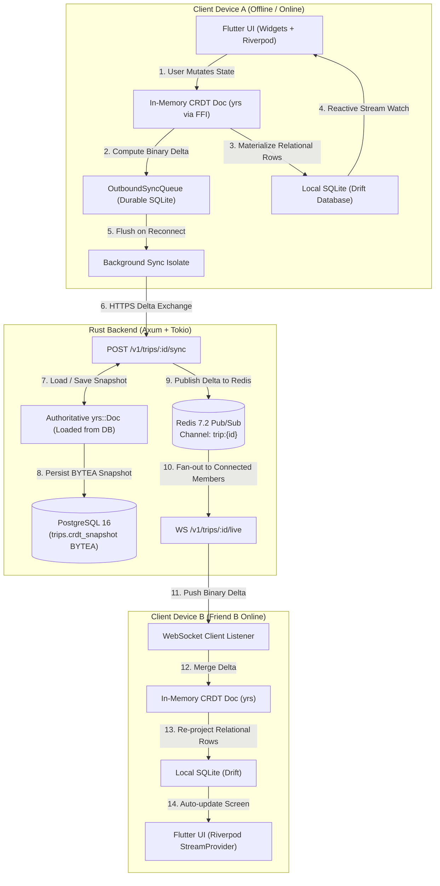

# Phase 2 Implementation Specification: Offline & CRDT Synchronization Engine

> **Scope**: This document outlines the complete architectural design, data structures, wire protocol, and implementation mechanics for **Phase 2 (Offline & CRDT Synchronization)** in TripWallet.

---

## 1. Executive Summary & Objective

In a group travel app, connectivity is unreliable (flights, remote hikes, underground venues, international roaming dead zones). 

A traditional REST architecture ("tap button -> show spinner -> wait for server response") fails completely offline. Furthermore, a naive "last-write-wins" (LWW) database model corrupts data when two users edit simultaneously (e.g., Alice claims "Burger" offline while Bob claims "Salad" offline; whoever reconnects second overwrites the first).

**Phase 2 achieves two hard guarantees:**
1. **Zero-Latency Optimistic UI**: All user mutations (adding expenses, claiming dishes, editing names) write directly to the local embedded Drift SQLite and in-memory CRDT document. The UI never waits for the network.
2. **Deterministic Conflict-Free Merging**: Client and server share the exact same Rust CRDT core (`yrs`). When devices reconnect after hours or days offline, their changes merge mathematically without data loss.

---

## 2. End-to-End Synchronization Architecture



---

## 3. The Shared CRDT Document Schema (`crdt-core`)

The CRDT schema is defined in Rust using **`yrs`** (the high-performance Rust port of Yjs) inside `crates/crdt-core`.

### Logical Document Model
```
TripCRDTDoc
├── "meta": YMap
│     ├── "name": LWW-Register<String>
│     ├── "currency": LWW-Register<String>
│     └── "status": LWW-Register<String> ("active" | "archived")
│
├── "members": YMap<MemberId, YMap>
│     └── MemberId:
│           ├── "display_name": LWW-Register<String>
│           ├── "avatar_url": LWW-Register<String?>
│           └── "role": LWW-Register<String> ("creator" | "member")
│
├── "expenses": YMap<ExpenseId, YMap>
│     └── ExpenseId:
│           ├── "title": LWW-Register<String>
│           ├── "amount_minor": LWW-Register<i64>
│           ├── "currency": LWW-Register<String>
│           ├── "paid_by": LWW-Register<Uuid>
│           ├── "split_method": LWW-Register<String>
│           ├── "tax_minor": LWW-Register<i64>
│           ├── "service_charge_minor": LWW-Register<i64>
│           └── "line_items": YMap<ItemId, YMap>
│                 └── ItemId:
│                       ├── "label": LWW-Register<String>
│                       ├── "price_minor": LWW-Register<i64>
│                       └── "claims": YArray<Uuid> (Add-only set of MemberIds)
│
└── "itinerary": YMap<ItemId, YMap>
      └── ItemId:
            ├── "day_index": LWW-Register<i32>
            ├── "type": LWW-Register<String>
            ├── "title": LWW-Register<String>
            └── "start_time": LWW-Register<String>
```

### Why This Schema Guarantees Conflict Resolution:
1. **Scalar Properties (Title, Amount, Dates)** use **Last-Write-Wins Registers (LWW)** with logical lamport timestamps. If Alice renames "Dinner" to "Italian Dinner" and Bob renames it to "Pizza Night", the later timestamp wins deterministically.
2. **Item Claims (Dishes)** use **`YArray` / Add-Only Sets**:
   - If Alice claims the *Calamari* while offline, and Bob also claims the *Calamari* while offline, merging does **not** overwrite one with the other.
   - The merge result is: `claims = [AliceId, BobId]`.
   - The domain proration engine then automatically splits the item $50\% / 50\%$ between both of them.

---

## 4. The Sync Protocol & Wire Contract

Instead of dozens of chatty CRUD endpoints, mutations synchronize via a single binary delta endpoint.

### 1. HTTP Synchronization Endpoint
- **Method**: `POST`
- **Path**: `/v1/trips/{trip_id}/sync`
- **Headers**:
  - `Authorization: Bearer <guest_jwt>`
  - `Content-Type: application/json`

#### Request Payload:
```json
{
  "client_state_vector": "<base64 encoded StateVector>",
  "pending_updates": [
    "<base64 encoded Yjs Update 1>",
    "<base64 encoded Yjs Update 2>"
  ]
}
```

#### Response Payload:
```json
{
  "server_updates": [
    "<base64 encoded Yjs Update of changes Client hasn't seen>"
  ],
  "new_state_vector": "<base64 encoded StateVector>"
}
```

### 2. How State Vectors Work (Bandwidth Optimization)
- A **State Vector** is a compact fingerprint representing: *"I have received up to clock tick $K$ from client $X$, tick $M$ from client $Y$."*
- Size: **typically < 100 bytes**, regardless of how many thousands of expenses exist in the trip.
- When Client sends its State Vector, Server calculates:
  ```rust
  let missing_for_client = server_doc.diff_since_state_vector(&client_sv);
  ```
- **Only the missing bytes** are returned over the wire. If nothing changed, `server_updates` is empty (`[]`).

### 3. Realtime WebSocket Protocol
- **Path**: `WS /v1/trips/{trip_id}/live`
- When any device calls `POST /v1/trips/{id}/sync`, the server publishes the merged delta to Redis:
  ```rust
  redis.publish(format!("trip:{}", trip_id), &merged_update_bytes).await?;
  ```
- All connected WebSocket clients receive the binary delta and execute `local_doc.apply_update(&bytes)`.

---

## 5. Client Implementation: The Dual-Layer Data Pipeline

### Step 1: The Outbound Sync Queue Table ([`app_database.dart`](client/lib/core/db/app_database.dart))
Whenever the user performs an action (e.g. adding an expense):
```dart
// 1. Mutate local CRDT doc
final deltaUpdateBytes = crdtBridge.claimItem(tripId, itemId, currentMemberId);

// 2. Queue in durable SQLite table
await db.into(db.outboundSyncQueue).insert(
  OutboundSyncQueueCompanion.insert(
    tripId: tripId,
    crdtUpdate: deltaUpdateBytes,
    status: const Value('pending'),
  ),
);

// 3. Trigger immediate optimistic background sync if online
ref.read(syncEngineProvider).triggerFlush();
```

### Step 2: Background Sync Engine Isolate
The sync engine operates independently in a background Dart isolate:
1. **Connectivity Listener**: Monitors `connectivity_plus`. When network changes from `none` to `mobile/wifi`, it triggers a flush.
2. **App Lifecycle Listener**: Runs on app startup and whenever the app resumes from the background.
3. **Flush Algorithm**:
   - Query all rows from `OutboundSyncQueue` where `status == 'pending'`.
   - Read local State Vector from `crdt-core`.
   - Call `POST /v1/trips/{id}/sync`.
   - On `200 OK`:
     - Apply returned `server_updates` into local `crdt-core` doc.
     - Project changes into Drift SQLite (`LocalExpenses`, `LocalItemClaims`).
     - Delete synced rows from `OutboundSyncQueue`.
   - On Network Failure / Offline:
     - Mark rows back to `pending` and back off exponentially (1s, 2s, 4s...). **No data is lost.**

---

## 6. Detailed Implementation Tasks for Phase 2

### Backend Tasks (`backend/`)
1. **Expand `crdt-core`**:
   - Implement `TripCrdtDoc` domain helpers: `add_expense()`, `claim_item()`, `edit_expense()`, `add_itinerary()`.
   - Add property-based commutativity test (`proptest` verifying out-of-order delta replays).
2. **Implement PostgreSQL Materialized Projector** (`crates/persistence/src/projector.rs`):
   - Whenever `trips.crdt_snapshot` updates, the projector parses the CRDT doc and upserts standard SQL rows (`expenses`, `expense_splits`, `settlements`) so reports and dashboard queries remain fast.
3. **Build Axum Sync Endpoint** (`crates/api/src/routes/sync.rs`):
   - Handle `POST /v1/trips/:id/sync` with authorization checks.
4. **Build WebSocket Relay** (`crates/api/src/ws/trip_room.rs`):
   - Upgrade HTTP to WebSocket, subscribe connection to Redis pub/sub `trip:{id}`, relay messages.

### Frontend Client Tasks (`client/`)
1. **`flutter_rust_bridge` / FFI Bindings**:
   - Compile `crdt-core` crate into a dynamic C library (`libtripwallet_crdt.so` on Android / `.dylib` on iOS/macOS) and generate Dart FFI bindings.
2. **Drift Projector**:
   - Re-project incoming CRDT deltas into Drift tables (`LocalTrips`, `LocalExpenses`, `LocalLineItems`, `LocalItemClaims`).
3. **Sync Engine Notifier**:
   - Create `SyncEngine` class that reads from `OutboundSyncQueue` and coordinates with `Dio` network client.
4. **Offline UI Status Banner**:
   - Wire the global status banner (`"Offline · 3 changes pending sync"`) reacting to `OutboundSyncQueue` count.

---

## 7. Verification & Testing Strategy for Phase 2

| Test Category | Target Component | Verification Command | Expected Outcome |
| :--- | :--- | :--- | :--- |
| **CRDT Commutativity** | `crdt-core` | `cargo test -p tripwallet-crdt-core` | 100 out-of-order & duplicate update replays result in identical document state. |
| **Sync Endpoint Integration** | `api` + `persistence` | `cargo test -p tripwallet-api` | Two simulated clients sync deltas through Axum and converge to equal snapshots. |
| **Offline SQLite Queue** | Drift Client | `flutter test test/sync_queue_test.dart` | Local mutations survive app restart in `OutboundSyncQueue` and flush upon simulated reconnect. |
| **Multi-Device Simulation** | Client + Server | E2E Integration Script | Device A updates while offline $\to$ connects $\to$ Device B sees live update via WebSocket $< 200\text{ms}$. |
