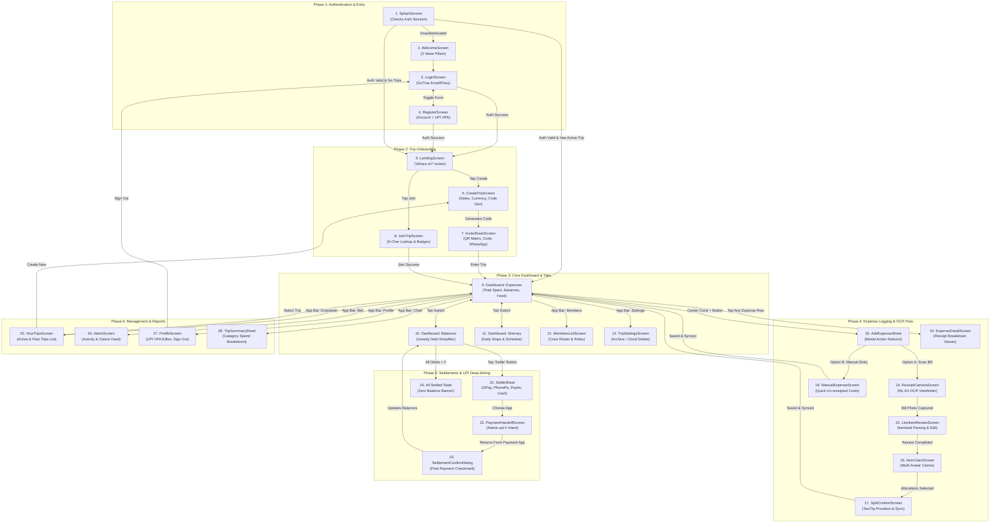

# TripWallet — Complete Screen Architecture & User Flow Guide

This document provides a comprehensive, visual walkthrough of **all 28 screens** designed and implemented in TripWallet, detailing their roles, navigation pathways, and cloud backend connections.

---

## 1. High-Level System Architecture & Flow



---

## 2. Detailed Breakdown of All 28 Screens

### Phase 1: Authentication & Identity

#### 1. [`SplashScreen`](file:///home/chakshit-2004/tripwallet/client/lib/features/onboarding/presentation/splash_screen.dart)
* **Visual Role**: Dark-ink branded boot screen with coral geometry mark and wordmark.
* **Functional Role**: Verifies persistent Supabase user sessions. Reads cached SQLite trips to skip re-authentication.
* **Connected To**: `WelcomeScreen` (if unauthenticated), `LandingScreen` (if new user without trips), or `TripDashboardScreen` (if active trip exists).

#### 2. [`WelcomeScreen`](file:///home/chakshit-2004/tripwallet/client/lib/features/onboarding/presentation/welcome_screen.dart)
* **Visual Role**: Value proposition carousel featuring the 3 core pillars (Camera OCR, QR Crew Joins, 1-Tap UPI Settlement).
* **Functional Role**: Introduces first-time users to the zero-math philosophy.
* **Connected To**: `LoginScreen` / `RegisterScreen`.

#### 3. [`LoginScreen`](file:///home/chakshit-2004/tripwallet/client/lib/features/auth/presentation/login_screen.dart)
* **Visual Role**: Clean paper-themed login form with email, password, and error banners.
* **Functional Role**: Calls `supabase_auth_service.signIn()`, restores user session tokens, and fetches user profiles.
* **Connected To**: `LandingScreen` (success) or `RegisterScreen` (toggle link).

#### 4. [`RegisterScreen`](file:///home/chakshit-2004/tripwallet/client/lib/features/auth/presentation/register_screen.dart)
* **Visual Role**: Registration form collecting Display Name, Email, Password, and Default UPI ID (VPA).
* **Functional Role**: Calls `supabase_auth_service.signUp()` and seeds the cloud `profiles` table with default UPI payment handles.
* **Connected To**: `LandingScreen` upon account confirmation.

---

### Phase 2: Trip Onboarding & Guest Joining

#### 5. [`LandingScreen`](file:///home/chakshit-2004/tripwallet/client/lib/features/onboarding/presentation/landing_screen.dart)
* **Visual Role**: "Where to?" action screen with two distinct cards: "Create a trip" and "Join a trip".
* **Functional Role**: Gateway for users who are authenticated but do not currently have an active trip loaded.
* **Connected To**: `CreateTripScreen` or `JoinTripScreen`.

#### 6. [`CreateTripScreen`](file:///home/chakshit-2004/tripwallet/client/lib/features/onboarding/presentation/create_trip_screen.dart)
* **Visual Role**: Trip creation card with dashed cover placeholder, trip name field, date pickers, and currency selector (INR, USD, EUR, GBP, JPY).
* **Functional Role**: Generates a cryptographically random 6-character code (e.g. `9F2K4B`), inserts into Supabase `trips`, adds the user as `creator` in `trip_members`, and caches to Drift SQLite.
* **Connected To**: `InviteShareScreen`.

#### 7. [`InviteShareScreen`](file:///home/chakshit-2004/tripwallet/client/lib/features/onboarding/presentation/invite_share_screen.dart)
* **Visual Role**: Dedicated crew invitation card with a 150×150 QR matrix, link copy box (`tripwallet.app/j/CODE`), and a WhatsApp share button.
* **Functional Role**: Allows the trip creator to distribute the join code to group members.
* **Connected To**: `TripDashboardScreen`.

#### 8. [`JoinTripScreen`](file:///home/chakshit-2004/tripwallet/client/lib/features/onboarding/presentation/join_trip_screen.dart)
* **Visual Role**: 6-character uppercase invite code input with live cloud trip preview, custom nickname field, and avatar selector.
* **Functional Role**: Queries Supabase `trips` by `invite_code`, validates code, and joins the user into `trip_members`.
* **Connected To**: `TripDashboardScreen`.

---

### Phase 3: Core Dashboard & Trip Operations

#### 9. [`TripDashboardScreen (Expenses Tab)`](file:///home/chakshit-2004/tripwallet/client/lib/features/trip_dashboard/presentation/trip_dashboard_screen.dart)
* **Visual Role**: Header with trip name dropdown, member count, dates, stat cards (*Total spent*, *You're owed / You owe*), and chronological expense list.
* **Functional Role**: Primary hub. Streams expenses from Drift SQLite & Supabase Realtime, categorizes spending, and displays empty states when no expenses exist.
* **Connected To**: All tabs, `ExpenseDetailScreen`, `AddExpenseSheet`.

#### 10. [`TripDashboardScreen (Balances Tab)`](file:///home/chakshit-2004/tripwallet/client/lib/features/trip_dashboard/presentation/trip_dashboard_screen.dart)
* **Visual Role**: "Who owes who" view with individual debtor/creditor breakdown cards and dark pill **"Settle"** buttons.
* **Functional Role**: Executes `DebtSimplifier.simplifyDebts()` using greedy debt reduction to minimize total transactions across group members.
* **Connected To**: `SettleSheet`.

#### 11. [`ItineraryTabView`](file:///home/chakshit-2004/tripwallet/client/lib/features/itinerary/presentation/itinerary_tab_view.dart)
* **Visual Role**: Day selector pills (*Day 1, Day 2, Day 3*) with cards for hotels, meals, and activities.
* **Functional Role**: Organizes daily plans backed by `localItineraryStops` table.
* **Connected To**: `AddStopSheet`.

#### 12. [`MembersListScreen`](file:///home/chakshit-2004/tripwallet/client/lib/features/trip_dashboard/presentation/members_list_screen.dart)
* **Visual Role**: Crew roster displaying member names, `creator` badges, and remove actions.
* **Functional Role**: Displays real-time group members from Supabase `trip_members` and provides a re-share invite button.
* **Connected To**: `InviteShareScreen`.

#### 13. [`TripSettingsScreen`](file:///home/chakshit-2004/tripwallet/client/lib/features/trip_dashboard/presentation/trip_settings_screen.dart)
* **Visual Role**: Settings view showing trip name, currency symbol, member count, and destructive actions.
* **Functional Role**: Allows group admins to archive or permanently delete trips from both cloud and local databases.
* **Connected To**: `YourTripsScreen`.

---

### Phase 4: Expense Logging & OCR Bill Splitting

#### 14. [`ReceiptCameraScreen`](file:///home/chakshit-2004/tripwallet/client/lib/features/expenses/presentation/receipt_camera_screen.dart)
* **Visual Role**: Fullscreen camera interface with rectangular document overlay, auto-crop guidelines, flash toggle, and photo shutter.
* **Functional Role**: Captures bill images and passes them to on-device Google ML Kit OCR text recognition.
* **Connected To**: `LineItemReviewScreen`.

#### 15. [`LineItemReviewScreen`](file:///home/chakshit-2004/tripwallet/client/lib/features/expenses/presentation/line_item_review_screen.dart)
* **Visual Role**: Scanned bill review displaying parsed dishes, drinks, prices, and OCR confidence indicators.
* **Functional Role**: Allows users to correct typos, adjust detected prices, delete unwanted rows, and insert missed items.
* **Connected To**: `ItemClaimScreen`.

#### 16. [`ItemClaimScreen`](file:///home/chakshit-2004/tripwallet/client/lib/features/expenses/presentation/item_claim_screen.dart)
* **Visual Role**: Interactive table where users tap avatar badges next to dishes to claim what they ate or drank.
* **Functional Role**: Calculates fractional shares when multiple people share an item (e.g. 3 people sharing a pizza = $\frac{1}{3}$ each).
* **Connected To**: `SplitConfirmScreen`.

#### 17. [`SplitConfirmScreen`](file:///home/chakshit-2004/tripwallet/client/lib/features/expenses/presentation/split_confirm_screen.dart)
* **Visual Role**: Financial breakdown displaying food subtotal, taxes, tips, payer selector, and total amount.
* **Functional Role**: Runs the Proration Engine (mathematically distributes service charge/taxes proportional to item subtotal), saves to Drift SQLite, and syncs to Supabase.
* **Connected To**: Returns to `TripDashboardScreen`.

#### 18. [`ManualExpenseScreen`](file:///home/chakshit-2004/tripwallet/client/lib/features/expenses/presentation/manual_expense_screen.dart)
* **Visual Role**: Form for non-receipted expenses (taxis, scooter rentals, groceries) with amount, title, and payer selection.
* **Functional Role**: Inserts equal-split manual expenses directly into local and cloud databases.
* **Connected To**: Returns to `TripDashboardScreen`.

#### 19. [`ExpenseDetailScreen`](file:///home/chakshit-2004/tripwallet/client/lib/features/expenses/presentation/expense_detail_screen.dart)
* **Visual Role**: Full receipt inspector showing timestamp, payer, item breakdown, and individual member shares.
* **Functional Role**: Read-only breakdown accessible by tapping any logged expense on the dashboard.
* **Connected To**: Back to `TripDashboardScreen`.

#### 20. [`AddExpenseSheet`](file:///home/chakshit-2004/tripwallet/client/lib/features/expenses/presentation/add_expense_sheet.dart)
* **Visual Role**: Bottom sheet modal triggered by the center coral camera button in the navigation bar.
* **Functional Role**: Gives users the choice between **"Scan bill"** (Camera OCR) and **"Manual entry"**.
* **Connected To**: `ReceiptCameraScreen` or `ManualExpenseScreen`.

---

### Phase 5: Balances & Native UPI Settlement Flow

#### 21. [`SettleSheet`](file:///home/chakshit-2004/tripwallet/client/lib/features/balances_settlement/presentation/settle_sheet.dart)
* **Visual Role**: Bottom sheet modal showing debtor, creditor, amount owed, and payment app selector (Google Pay, PhonePe, Paytm, Revolut, Cash).
* **Functional Role**: Gathers payee VPA and settlement details for launching external payment apps.
* **Connected To**: `PaymentHandoffScreen`.

#### 22. [`PaymentHandoffScreen`](file:///home/chakshit-2004/tripwallet/client/lib/features/balances_settlement/presentation/payment_handoff_screen.dart)
* **Visual Role**: Clean animated screen with pulsing bolt logo and payment details.
* **Functional Role**: Builds native `upi://pay?pa=...&am=...&pn=...` URI intent and launches the selected external UPI app.
* **Connected To**: `SettlementConfirmDialog`.

#### 23. [`SettlementConfirmDialog`](file:///home/chakshit-2004/tripwallet/client/lib/features/balances_settlement/presentation/settlement_confirm_dialog.dart)
* **Visual Role**: Checkmark confirmation modal asking if payment completed successfully.
* **Functional Role**: Records the transaction in Supabase `settlements` table, updates local SQLite balances, and adjusts net debt.
* **Connected To**: Returns to `TripDashboardScreen`.

#### 24. **All Settled State** (In Dashboard)
* **Visual Role**: Celebratory illustration and green badge displayed on the Balances tab when all group debts are cleared: *"All settled up! 🎉"*.
* **Functional Role**: Informs group members that no outstanding balances remain.

---

### Phase 6: Management, Reports & Utility

#### 25. [`YourTripsScreen`](file:///home/chakshit-2004/tripwallet/client/lib/features/trips/presentation/your_trips_screen.dart)
* **Visual Role**: Overview list showing active and past archived trips with status tags and "Create a trip" CTA button.
* **Functional Role**: Fetches all trips where the user is a member from Supabase with pull-to-refresh.
* **Connected To**: Switch active trip in `TripDashboardScreen` or navigate to `CreateTripScreen`.

#### 26. [`AlertsScreen`](file:///home/chakshit-2004/tripwallet/client/lib/features/alerts/presentation/alerts_screen.dart)
* **Visual Role**: Chronological activity feed showing recent expenses logged, debts settled, and new members joined.
* **Functional Role**: Keeps users updated on group changes made by other travelers.
* **Connected To**: Back to previous screen.

#### 27. [`ProfileScreen`](file:///home/chakshit-2004/tripwallet/client/lib/features/profile/presentation/profile_screen.dart)
* **Visual Role**: Account view showing user initials avatar, email, UPI VPA configuration card, and Sign Out button.
* **Functional Role**: Lets users update their UPI handle (VPA) so friends can pay them directly.
* **Connected To**: `LoginScreen` on Sign Out.

#### 28. [`TripSummarySheet`](file:///home/chakshit-2004/tripwallet/client/lib/features/trip_dashboard/presentation/trip_summary_sheet.dart)
* **Visual Role**: "Trip complete" summary modal opened via the chart icon in the dashboard app bar.
* **Functional Role**: Aggregates total expenses into categories (Stay, Food & Drink, Transport, Activities) and displays total spend across all group members with an Archive Trip action.
* **Connected To**: `YourTripsScreen`.

---

## 3. Database & Cloud Architecture

```
                      [ Client Application (Flutter) ]
                                     |
               +---------------------+---------------------+
               |                                           |
       [ Drift SQLite Cache ]                     [ Managed Supabase ]
    (Offline-First Fast Reads)                 (Cloud Sync & Multi-User)
       - localTrips                               - trips
       - localMembers                             - trip_members
       - localExpenses                            - expenses
       - localLineItems                           - expense_line_items
       - localItemClaims                          - expense_item_claims
       - localSettlements                         - settlements
       - localItineraryStops                      - profiles
       - outboundSyncQueue                        - GoTrue Auth (auth.users)
```

1. **Zero Hardcoded Data**: App boots dynamically based on real authenticated accounts.
2. **Multi-User Realtime Sync**: When one traveler logs an expense or settles a debt, all group members' screens update in real time.
3. **Offline Resilience**: Drift SQLite caches data locally so travelers can view and log expenses even in remote areas without internet connectivity.
